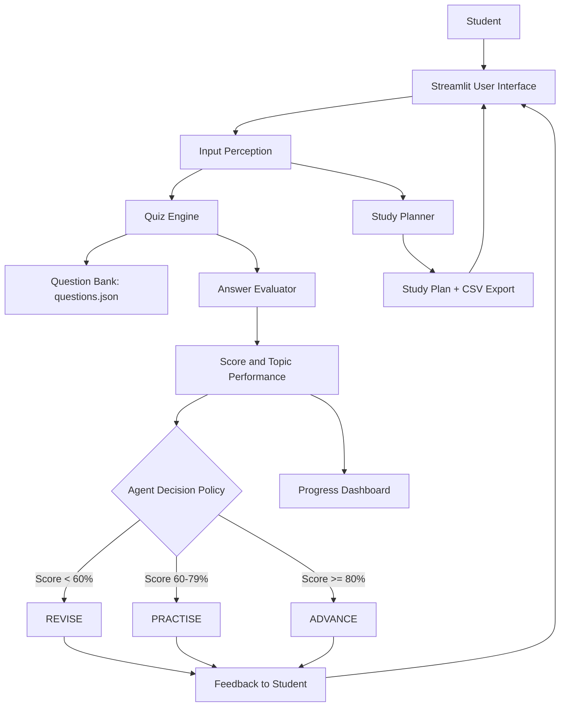

# System Schema: AI Study Companion Agent

## Architecture

## Agent design

- **Agent:** AI Study Companion.
- **Environment:** student, selected subject/topic, exam deadline, quiz responses.
- **Goal:** help a student plan revision and improve topic mastery.
- **Percepts:** topics entered, exam date, available study hours, selected quiz answers, past scores in the current session.
- **Actions:** generate study plan, present quiz, evaluate answers, recommend revision/practice/advancement, display progress.
- **Performance measures:** quiz accuracy, number of attempts, completion of planned sessions, and improvement in topic scores.
- **Decision policy:** score below 60% means revise; 60-79% means practise; 80% or above means advance.
- **Feedback loop:** each quiz submission updates the progress state and triggers a new recommendation.

## Data flow

1. Student enters topics and constraints in the UI.
2. Planner distributes topics over the available days and can export the result as CSV.
3. Quiz engine loads questions from `data/questions.json`.
4. Evaluator compares selected answers against answer keys and calculates the score.
5. Agent policy selects the next action from the score.
6. Dashboard displays attempts and topic averages.
7. Student acts on the recommendation and repeats the cycle.

## Important note

This implementation is a **rule-based agent**. Its decisions are automatic and goal-directed, but the policy is predefined rather than learned from data. This is a defensible beginner-level agentic system and is intentionally designed to run without an external API.
